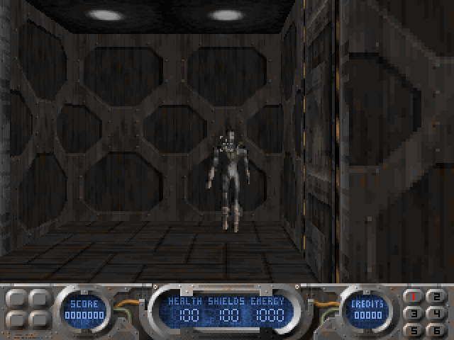
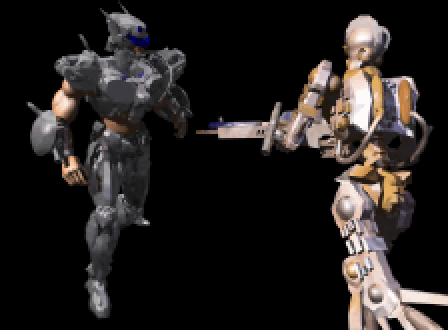
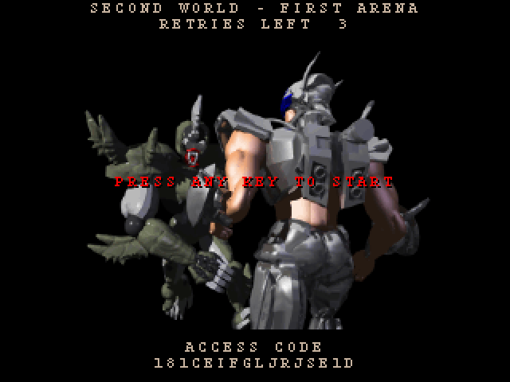
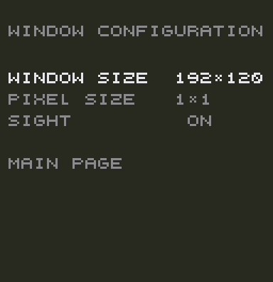
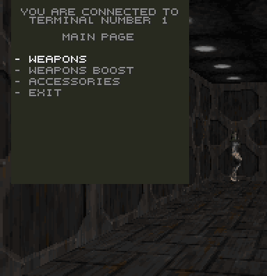
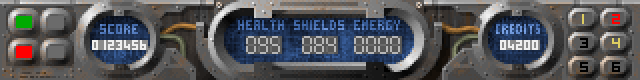

# Breathless Java

Portage en Java de **Breathless** (Fields of Vision, 1995-96), FPS texture-mappé pour
Amiga AGA. jMonkeyEngine fournit la fenêtre, le clavier et le son.



Le moteur est réécrit depuis l'assembleur 68k d'origine : raycaster, sprites, effets,
combat, IA, panneau de bord, carte, terminal, son et musique — et vérifié contre les
données du jeu.

**Ce n'est pas un émulateur**, ni de l'Amiga, ni même en partie du 68000 : aucune
instruction 68k n'est exécutée, et le binaire d'origine n'est pas chargé. Chaque routine
de l'assembleur a été lue et récrite en Java ; le jeu ne reprend de l'original que ses
**données** — niveaux, textures, sprites, sons, musiques —, lues dans les fichiers `.GLD`
tels qu'ils sont livrés. Rien n'émule non plus la puce graphique ni la puce sonore : le
rendu est un raycaster logiciel, la musique un lecteur ProTracker écrit pour l'occasion.


## Parti pris

**Port fidèle du raycaster.** Le moteur d'origine est réécrit en Java à l'identique :
lancer de rayons DDA une passe par colonne, rendu dans un tampon *chunky* 320x200 en
palette 256 couleurs. jMonkeyEngine n'affiche ce tampon que comme une texture plein
écran, et prend en charge la fenêtre, les entrées et l'audio.

Ce choix privilégie la fidélité au pixel plutôt que l'exploitation du GPU. Les
conséquences sont assumées :

- pas de vraie 3D, donc pas de rotation verticale libre — seulement le décalage vertical
  du regard (`LookHeight`) de l'original, que le portage reprend ;
- la géométrie reste contrainte à la grille de blocs ;
- l'essentiel du travail est du portage 1:1 de code assembleur documenté.

**Formats d'origine lus directement, et exportables.** Le jeu ouvre les `.GLD` tels
quels — décompression comprise — ce qui évite d'entretenir une copie des données. L'outil
`gld-cli` sert à les *inspecter* : il exporte textures, sprites, images, sons, modules
ProTracker et cartes en PNG, WAV et `.mod`. C'est par lui que chaque format a été vérifié
avant d'être branché dans le moteur.

## Structure

| Module | Rôle |
|---|---|
| `gld-core` | lecture des formats d'origine : décompression SLZ/VDCO, parseurs `.GLD` |
| `engine` | raycaster et rastérisation logicielle — Java pur, sans dépendance graphique |
| `gld-cli` | outils en ligne de commande : inspection, export PNG, rendu d'images fixes |
| `game` | coquille jMonkeyEngine : fenêtre, entrées, audio |

Le moteur est volontairement isolé de jMonkeyEngine : il produit un tampon 320×200 en
index de palette, que la coquille se contente d'afficher. Cela permet de le tester et de
le déboguer en écrivant des PNG, sans ouvrir de fenêtre.

Une image complète coûte environ **0,13 ms** sur un cœur, soit de l'ordre de 7 000 images
par seconde. Le rendu logiciel ne sera pas le facteur limitant, et rien n'est alloué
pendant une image.

### Les trois passes d'une image

1. **Rayons** — une DDA par colonne, qui n'enregistre que les *changements* de bloc.
2. **Murs** — pans verticaux du plus proche au plus lointain, avec deux bornes de découpe
   qui se resserrent. Les pixels laissés libres sont marqués « sol » ou « plafond » de tel
   bloc.
3. **Surfaces horizontales** — les pixels marqués sont regroupés en segments par ligne.
   Sur une ligne, la profondeur est constante : le placage y est affine, donc linéaire.
4. **Objets** — sprites triés du plus lointain au plus proche, chaque colonne découpée
   contre les bornes que la passe des murs a laissées à cette profondeur. Pas de tampon
   de profondeur : un objet derrière un mur disparaît de lui-même.

### Les effets

Chaque bloc porte un **numéro de trigger** ; tous ceux qui partagent le même numéro
bougent ensemble, ce qui fait qu'une porte large de trois cases s'ouvre d'un seul tenant.
Marcher sur un bloc déclenche sa liste d'effets, chaque entrée visant un trigger. Un effet
occupe un emplacement parmi 42 et avance d'un pas par cinquantième de seconde jusqu'à se
retirer de lui-même.

Les hauteurs de sol et de plafond vivent donc dans un **état mutable** du monde, séparé
des blocs issus du fichier, qui restent la description d'origine intacte.

Une porte refuse de se refermer sur le joueur ou sur un ennemi : elle repart vers le haut,
refait sa pause, et retente. Les restes d'un ennemi tombé dessous disparaissent quand elle
se referme.

Deux façons de finir, et la différence se voit : un effet qui va et vient — une porte, un
ascenseur — rend la main à son trigger, et repart au prochain passage ; un effet
**définitif** — un plafond qui descend, une porte qui reste ouverte, une lumière qui
change — la garde pour toujours. Sans cela, un plafond redescendrait à chaque passage
jusqu'à passer sous le sol.

Un interrupteur exige la **clé** que porte l'entrée : sans elle, rien ne s'ouvre et le jeu
le dit ; avec elle, la clé sert, et disparaît.

Les trois sortes de portes ne se ressemblent pas, et c'est le plan qu'elles déplacent qui
les distingue : **`DoorUp`** lève le plafond, **`Door2`** — la porte « a due ante », à deux
battants — lève le plafond *et* abaisse le sol d'autant, **`DoorDown`** abaisse le sol
seul. Le niveau 1 en compte huit, quatre de chaque sorte extrême ; les portes à deux
battants n'apparaissent qu'à partir du quatrième niveau.

### Les animations

Deux cadences, toutes deux plus lentes que l'affichage :

- **textures** : une image toutes les 8 (6,25 par seconde) ;
- **objets à animation simple** : une image toutes les 4 (12,5 par seconde).

L'animation d'un objet appartient à son **type**, pas à ses instances : tous les bidons
d'acide d'un niveau bouillonnent à l'unisson. Les ennemis ont leurs huit poses de marche,
calées sur l'horloge comme le fait `WALKANIM`, et leurs poses de tir et de chute ; tirs et
explosions avancent à 12,5 images par seconde.

Usage réel dans les vingt niveaux, qui a guidé les priorités :

| Effet | Occurrences | État |
|---|---:|---|
| Réveiller un ennemi | 519 | porté |
| Porte, Porte 2, Porte descendante | 311 | porté |
| Ascenseurs | 66 | porté |
| Sols et plafonds mobiles | 14 | porté |
| Lumières clignotantes | 39 | porté |
| Terminal, téléportation, fin de niveau | 112 | porté |
| Lumières liées | 37 | porté |

Les effets 1, 9, 10 et 18 du catalogue ne sont utilisés par aucun niveau.

La spécification des formats binaires est dans [`docs/formats-gld.md`](docs/formats-gld.md).

## Installer

La page des [releases](https://github.com/guillaumemonet/breathless-java/releases) porte
une archive par système. Il n'y a rien à installer : on décompresse, et on lance
`Breathless`. Le paquet porte son propre Java, aucun n'est requis sur la machine.

**Les données du jeu n'y sont pas** — ce dépôt n'en redistribue aucune. Au premier
lancement, le jeu demande s'il peut aller chercher l'archive des sources d'origine,
[mheyer32/Breathless](https://github.com/mheyer32/Breathless), soit environ 2,5 Mo. Il la
range une fois pour toutes dans le répertoire de l'utilisateur — `%LOCALAPPDATA%\Breathless\data`
sous Windows, `~/Library/Application Support/Breathless/data` sous macOS,
`~/.local/share/breathless/data` sous Linux — et les lancements suivants la retrouvent
sans rien demander.

Une copie locale l'emporte toujours, dans cet ordre : le répertoire donné en argument, la
propriété `-Dbreathless.data=<chemin>`, l'archive posée à côté du jeu, puis celle qu'un
lancement précédent a rangée. Qui a déjà les sources n'a donc rien à télécharger.

## Construire et lancer

Nécessite un JDK 21 (le *toolchain* Gradle s'en charge).

```bash
gradle build

# Inventaire des fichiers de données d'origine
gradle cli --args="probe <chemin vers les .GLD>"

# Résumé des vingt niveaux
gradle cli --args="levels <chemin vers les .GLD>"

# Détail d'un niveau, avec aperçu ASCII de la carte
gradle cli --args="level <chemin>/BLES0006.GLD"

# Export de la carte automatique d'un niveau, au départ puis complète
gradle cli --args="map <chemin vers les .GLD> <chemin>/BLES0006.GLD <sortie>"

# Export des dix images plein écran en PNG
gradle cli --args="pictures <chemin vers les .GLD> <répertoire de sortie>"

# Conversion des morceaux P61A en modules ProTracker, et rendu WAV
gradle cli --args="modules <chemin vers les .GLD> <répertoire de sortie>"

# Inventaire de la banque sonore et export des bruitages en WAV
gradle cli --args="sounds <chemin vers les .GLD> <répertoire de sortie>"

# Export des quatre pages du terminal
gradle cli --args="terminal <chemin vers les .GLD> <répertoire de sortie>"

# Export du panneau de bord, vide, rempli, et sous une vue de jeu
gradle cli --args="panel <chemin vers les .GLD> <répertoire de sortie>"

# Export de la palette, de la rampe d'éclairage et des 97 textures en PNG
gradle cli --args="textures <chemin vers les .GLD> <répertoire de sortie>"

# Export des sprites d'objets en PNG transparents
gradle cli --args="sprites <chemin vers les .GLD> <répertoire de sortie>"

# Rendu de vues fixes depuis le point de départ d'un niveau
gradle cli --args="render <chemin vers les .GLD> <chemin>/BLES0006.GLD <sortie>"
```

### Construire le paquet

```bash
gradle :game:packageZip
```

`jpackage` produit un répertoire autonome, avec son propre JRE et l'exécutable du jeu, que
la tâche compresse dans `game/build/distributions`. Il ne se construit que pour le système
qui le fabrique : c'est une contrainte de `jpackage`, pas un choix.

Le runtime est réduit aux modules réellement employés, et seuls les natifs LWJGL du
système visé sont embarqués — sans quoi l'archive pèserait le double.

### Jouer

```bash
gradle :game:run --args="<chemin vers les .GLD>"
```

| Touche | Action |
|---|---|
| Flèches, ZQSD ou WASD | avancer, reculer, tourner |
| `,` et `.` | pas de côté, qui se combine avec la rotation |
| Alt | pas de côté forcé (les touches gauche/droite se déplacent au lieu de tourner) |
| Début / Fin | regarder vers le haut / vers le bas ; Inser remet le regard droit |
| Espace, E ou Entrée | **actionner** : ouvrir une porte face à soi, appeler un ascenseur |
| Ctrl | tirer |
| Maj | courir |
| Tab | **carte** — elle remplace la vue et suspend le jeu, comme dans l'original |
| 1 à 6 | choisir une arme |
| X | arme suivante |
| + / − | agrandir ou réduire la fenêtre de jeu |
| Pavé 7 8 9 0 | grosseur des pixels : 1×1, 2×1, 1×2, 2×2 |
| Page préc. / suiv. | changer de niveau |
| P | pause |
| Échap | menu de configuration — il porte la commande de sortie |

Les commandes de la première moitié du tableau se redéfinissent dans la page clavier du
menu, comme les treize de l'original ; la carte, la pause, les armes et les réglages
d'affichage gardent leurs touches.

Au démarrage, le jeu affiche la carte graphique qu'il utilise (`GL_RENDERER`). Sur un
portable à deux cartes, Windows donne la carte intégrée à `java.exe` : le jeu le signale
alors à l'écran et demande s'il doit continuer. Le correctif : Paramètres Windows →
Système → Affichage → Graphiques → ajouter `java.exe` et `javaw.exe` → « Hautes
performances ». `-Dbreathless.gpu=ok` laisse l'avertissement mais ne pose plus la question.

La simulation tourne à **pas fixe, 50 Hz** — la fréquence PAL pour laquelle les constantes
de déplacement d'origine ont été réglées. L'affichage, lui, suit la fréquence de l'écran.

Les tests d'intégration sur les données d'origine sont ignorés si celles-ci sont
absentes. Pour les activer :

```bash
gradle test -Dbreathless.data=<chemin vers les .GLD>
```

### Les écrans fixes




La banque graphique contient dix images plein écran — le titre, les quatre présentations
de monde, deux logos, les crédits, la bannière de fin de partie et l'écran final. Toutes
sont compressées en **VDCO**, la même compression que les conteneurs `.GLD`. Chaque image
porte sa propre palette, qui remplace celle du jeu le temps de l'afficher, et sa propre
position : le titre couvre l'écran, la bannière de fin ne fait que 288×40 et se pose au
milieu.

La séquence est celle de l'original. Les deux logos puis le titre, sur la musique des
titres ; une touche ouvre le menu de la présentation, d'où **START GAME** lance la partie
au niveau que dit le code d'accès. Chaque niveau s'ouvre sur son **écran de chargement** :
l'image du monde, le nom du monde et de l'arène lus dans le fichier maître
`BREATHLESS.GLD`, les tentatives restantes et le code d'accès, sur la musique `MUSL` ;
une touche lance le niveau. La mort fait s'effondrer le joueur, puis reprend le niveau
s'il reste des tentatives ; sinon la bannière de fin de partie, puis le titre — le code
d'accès reste celui du dernier niveau atteint. Les crédits, l'écran final et la bannière
passent seuls au bout de leur temps, une touche les abrège.



Les textes de l'écran de chargement sont posés où `LoadingScreen` les pose, dans les
couleurs 254 et 255 de la palette de l'image — d'où le rouge de « PRESS ANY KEY TO
START ». Le premier niveau du premier monde n'affiche pas de code : c'est le code de
départ.

### La fenêtre de jeu


Huit tailles, de 96×60 à 320×200 par pas de 32×20, et quatre grosseurs de pixel : 1×1,
2×1, 1×2, 2×2. C'est ainsi que l'original se réglait pour gagner de la vitesse — moins de
colonnes et de lignes à calculer, l'image restant de même taille à l'écran. Le rendu se
fait à la taille réduite puis se répète : un pixel double est un gros pixel, pas une image
lissée.

Une fenêtre réduite laisse voir la **tenture** qui l'entoure, `Graphic/Background01.raw`,
une tuile de 128×128 répétée sur toute la vue.

### Les codes de niveau

Seize caractères rendent une partie : santé, boucliers, énergie, crédits, les six armes
avec leur amélioration, l'arme en main, le monde et le niveau. Dix octets sont assemblés,
brouillés par un ou exclusif avec une clé de 32 bits, puis découpés en seize groupes de
cinq bits — d'où un alphabet de trente-deux symboles, `1` à `9` puis `A` à `W`.

Le portage est **exact** : le code de départ écrit en dur dans le jeu,
`181CEIGGLJRJSE2T`, se relit et **se réécrit caractère pour caractère**. Un test le
vérifie, et c'est lui qui a révélé le seul écart qui restait — l'original applique sa clé
en deux mots longs puis *un mot*, si bien que les deux derniers octets voient le mot bas
de la clé et non son mot haut.

L'écran de chargement de chaque niveau montre son code, qui devient le code d'accès. Il se
saisit dans les options de jeu, avant la partie, et s'accepte aussi au lancement :

```bash
gradle run --args="../Breathless 181CEIGGLJRJSE2T"
```

### La carte


Tabulation montre la carte : elle remplace la vue et suspend le jeu, exactement comme
l'original. Le relevé se fait en avançant — trois rayons partent du regard du joueur et
marquent les cases traversées jusqu'à un mur ou une porte fermée. Le tracé dit ce que vaut
chaque passage : **blanc** infranchissable, **gris** franchissable, **jaune** marche ou
changement de plafond, fond sombre pour le sol déjà relevé.

### Le son

La banque `SGLD` a la même forme que la banque graphique : un catalogue de noms de quatre
caractères, chacun pointant sur un enregistrement de seize octets — longueur, période
Amiga, volume, boucle, priorité, canaux, type. Trois sortes d'enregistrements, que
`InitAudio` démêle et que le parseur reproduit :

- l'échantillon suit l'en-tête ;
- l'en-tête porte le **nom d'un autre son**, dont il reprend l'échantillon avec sa propre
  période et son propre volume — le cri d'un Devil est celui d'un autre monstre, joué plus
  bas ;
- l'en-tête est un **tirage au sort** entre trois sons nommés.

Quarante des quarante-sept entrées sont des bruitages, sept sont des morceaux. La fréquence
se déduit de la période : `3 546 895 / période`, l'horloge PAL.

Les bruitages sont joués : porte qui roule puis qui bute, interrupteur, téléport, pas,
ramassage, tir, arme vide, impact, mort, explosion, réveil d'ennemi, cri du joueur. Comme
sur l'Amiga, ils se partagent **quatre canaux** : chacun a sa priorité, que la distance
abaisse, et son volume baisse avec elle jusqu'à se taire au-delà de vingt-deux blocs. Un
son « seul » ne se relance pas tant qu'il joue, et une porte garde son canal, si bien que
le choc de fin de course coupe le roulement.

#### La musique

Les sept morceaux sont au format **P61A** — The Player 6.1, un empaqueteur de modules
ProTracker. Le décodeur est écrit d'après la **description publique du format**, celle de
l'outil [p61aconv](https://github.com/howprice/p61aconv) de Huw Price sous licence MIT,
elle-même adossée au guide Player61A. Il n'emprunte rien au lecteur d'origine, qui
appartient à Jarno Paananen : c'est le format qui est réimplémenté, pas son code.

Un module P61A range ses motifs piste par piste et les comprime par répétition : lignes
vides, lignes identiques, et sauts en arrière pour rejouer un bloc déjà lu. Une fois
déplié, on retrouve du ProTracker exact — même table de périodes, mêmes effets.

La conversion est vérifiée sur les sept morceaux : **aucune des quelque 8 300 notes ne
tombe hors de la table des périodes ProTracker**, les fichiers `.mod` produits ont
exactement la taille que leur en-tête annonce, et les séquences ne visent que des motifs
existants.

Un lecteur ProTracker rend ensuite le morceau en audio — quatre voies mélangées, arpège,
portamento, vibrato, glissements de volume, sauts de position et de motif, réglages de
vitesse. Le rendu se fait une fois, à l'écart du fil principal, puis le morceau tourne en
boucle.

### Le téléport et la fin de niveau

Le téléport fond l'image vers le brouillard puis la ramène, et gèle le jeu le temps de
l'aller-retour ; à trente-deux cinquantièmes, au plus fort du fondu, le joueur est déposé
au centre de la case visée, élan coupé. La fin de niveau lève le drapeau de sortie ; la
boucle principale fond alors l'image au noir avant d'enchaîner, et chaque niveau s'ouvre
par le fondu inverse.

La **lumière liée** suit la course d'un autre effet : une porte qui monte éclaire la pièce
à mesure qu'elle s'ouvre, proportionnellement à son avancement.

### Le menu de configuration



Échap ouvre le menu, sur le même moniteur que le terminal — même police, mêmes pages,
mêmes positions que `conf_page0` à `conf_page5`. En jeu : retour au jeu, fenêtre, son,
clavier, contrôles et **QUIT GAME**, qui demande « REALLY QUIT ? (Y/N) » et ramène à la
présentation. Avant la partie : **START GAME**, les mêmes pages, les options de jeu et les
crédits. Les flèches déplacent le choix — d'un bout à l'autre de la page —, gauche et
droite font défiler une valeur, Espace valide.

La page **clavier** redéfinit les treize commandes de l'original : choisir une ligne met le
menu en attente, la touche suivante est affectée, et la commande qui l'employait la perd.
Les touches réservées — Tab, Échap, P, 1 à 6, F1 à F6 et les touches fixes du portage —
sont refusées, comme `keylist` les refusait. Échap abandonne.


La page **contrôles** règle l'inertie de la marche et de la rotation, et les vitesses, à
pied et en course, comme `AdjustConfigVars` les traduisait.

La page **options de jeu**, avant la partie, laisse **saisir** le code d'accès — vérifié,
« BAD ACCESS CODE ! » sinon —, le remettre au code de départ, et enregistrer les réglages
dans `breathless.config`, repris au lancement suivant.

### Le terminal



Un effet de bloc ouvre le terminal, et le jeu s'arrête tant qu'il est là — le premier
niveau en compte un, les suivants jusqu'à trois. C'est la **seule source d'armes du jeu** :
`CollectWeapon` et `BoostWeapon` ne sont appelés de nulle part ailleurs. Quatre pages —
accueil, armes, améliorations, accessoires — avec les prix d'origine, de 150 crédits pour
dix points de bouclier à 35 000 pour la Death Machine.

On y navigue avec les mêmes touches qu'en jeu : avancer et reculer déplacent le choix,
Espace valide.

L'original dessine ce menu avec des sprites matériels, sur un moniteur de 128×132 posé en
haut à gauche, en deux couleurs sur fond transparent. Les textes, leurs positions et les
prix sont ceux d'origine ; le fond est ici opaque, faute de quoi le texte se perd dans le
décor, et les teintes exactes des sprites ne se déduisent pas de la source.

### Le combat

Le tir se compte en **pressions**, pas en temps : chaque appui met un tir en file, la file
se vide d'un tir par image, et il n'y a pas d'autre délai de rechargement. Toutes les armes
sont donc au coup par coup — sauf le lance-flammes, seul à porter le bit qui le rend
continu. Aucune arme n'a l'autofire dans les données, et le code qui l'aurait géré est
commenté dans l'original.

Un ennemi abattu **tombe** dans la direction du tir, à huit pas par image, puis reste au
sol : il n'est plus un ennemi, ne bouge plus et n'arrête plus les tirs. La chute n'a pas
une longueur fixe — elle s'arrête dès que l'image ne change plus, ce qui fait deux images
pour les uns et trois pour les autres.

Cinq des douze ennemis — WALK, EYE1, SKUL, TERM et SPID — n'ont **pas** d'animation de
chute et **explosent** sur place. C'est leur dernière image de tir, égale à ce qui serait
la première de leur chute, qui le dit. Ce qu'ils laissent dépend ensuite de leur
explosion : le cadavre de l'ennemi pour les uns, la dernière image de l'explosion pour les
autres. Dans tous les cas il reste quelque chose au sol. Un tir qui explose lui-même — les
boules de feu, le plasma — fait exploser n'importe quel ennemi, chute ou non.

Les ennemis ne décident pas à chaque pas : `obj_cont1` espace leurs décisions, de trois
passages quand ils visent à quarante-sept après un obstacle, ce qui leur donne leurs
lignes droites. Ils contournent un obstacle dans un sens qu'ils gardent jusqu'à passer, ne
se traversent pas, frappent le joueur au contact, et ne bougent que s'ils sont à moins de
vingt blocs ou ont été vus à la dernière image.

Ces trois comparaisons portent sur l'**identité** des images, pas sur leur contenu : le
moteur d'origine compare des pointeurs, et la banque d'objets partage donc une seule
instance par image, si souvent qu'elle soit citée.

Un corps qui s'abat **n'encaisse plus rien**. Le tir s'arrête bien sur lui, mais ne le
blesse ni ne le tue une seconde fois — `MSctrlobjcoll1` le dit en toutes lettres, *« se il
nemico sta cadendo non deve ucciderlo di nuovo »*. Sans cela une rafale rend au corps un
statut vivant en pleine chute : il cesse d'être mort sans redevenir vivant, se fige, et le
rendu lui reprend une pose de marche — l'ennemi reste debout.

Un statut négatif — l'ennemi tire, tombe, ou gît — fait prendre son image à l'index
absolu, sans passer par l'octant de direction.

Trois tentatives, comme dans l'original : la mort en consomme une et relance le niveau ;
à court, la partie s'arrête et l'on revient au titre.

### Les objets

Les sprites sont encodés en « posts » à la Doom : par colonne, des segments verticaux
opaques séparés par du vide. Quarante-trois types d'objets, dont une douzaine d'ennemis,
chacun avec ses poses directionnelles et ses animations de marche, de blessure et de mort.


### Les objets en attente

Près de la moitié des objets d'un niveau attendent un déclencheur — dix-huit sur
trente-neuf au premier niveau. Cette attente ne les rend pas absents : le moteur d'origine
les inscrit dans la carte dès le chargement (`InitObjects`, TMapMain.asm) et ne consulte
`obj_inactive` qu'au moment de faire bouger les ennemis. Un ennemi en attente **se voit,
arrête les tirs et encaisse** ; il reste seulement immobile jusqu'à son réveil.

### Le panneau de bord



L'écran d'origine fait 320×240 : la vue occupe les deux cents premières lignes, le panneau
les quarante dernières. Son fond n'est pas dans un `.GLD` — il était assemblé dans
l'exécutable par `incbin "Graphic/Panel04.raw"`, une image de huit plans de bits que
`PlanarImage` déplie en index de palette. Les chiffres viennent des deux polices de
`Text.asm`, transcrites une fois pour toutes dans `ScoreFont`.

Une installation qui ne contiendrait que les fichiers de données n'aura pas cette image :
le jeu démarre alors sans panneau et reprend le compte-rendu en console.

### La palette et la rampe d'éclairage

Les 256 couleurs du jeu, et les trente-deux niveaux d'éclairage qui les font s'assombrir
avec la distance — un simple tableau d'index vers index, comme dans l'original.


## Écarts assumés

Le portage suit le moteur d'origine jusque dans ses bizarreries. Quelques points méritent
d'être signalés parce qu'ils surprennent :

- **Un tir ne teste pas la hauteur de sa cible.** L'original n'en tient compte que pour le
  joueur ; viser au-dessus d'un ennemi ne le sauve pas.
- **Les décors arrêtent les tirs.** Tout objet de type inférieur ou égal à un ennemi fait
  obstacle : un pilier protège ce qui est derrière.
- **Entre deux cibles à portée, c'est la plus proche qui encaisse.** L'original prend la
  première de sa liste de case, c'est-à-dire un ordre de placement — deux ennemis côte à
  côte se volaient alors les coups.

Et quelques écarts de forme, faute d'équivalent :

- **Le moniteur du terminal et des menus a un fond opaque**, là où l'original emploie des
  sprites transparents ; ses teintes exactes ne se déduisent pas de la source. Les
  messages en jeu, eux, s'impriment en transparence.
- **La souris n'est pas employée** : la page des contrôles ne propose que le clavier. Le
  **filtre audio**, un passe-bas du matériel Amiga, cède sa ligne à l'interrupteur des
  bruitages.
- **Les touches par défaut** suivent les habitudes d'aujourd'hui ; celles de l'original —
  Alt gauche pour tirer, Ctrl pour courir, Maj pour le pas de côté — se rétablissent dans
  la page clavier.
- **Les textures animées** avancent à 6,25 images par seconde, la cadence voulue. Celle de
  l'original dépendait de la vitesse d'affichage de la machine.
- **L'écran de chargement** écrit avec une police à chasse fixe de huit pixels : celle de
  l'original, la police système de l'Amiga, ne fait pas partie des données.
- **Un son qui boucle** — seul le lance-flammes le fait — reprend tout son échantillon, là
  où l'original ne reprend que la partie qui suit le point de boucle.
- **Les pixels** sont en 1×1 au premier lancement, et non en 2×2.

L'audit qui a comparé le portage aux sources, point par point, est dans
[`docs/audit-sources.md`](docs/audit-sources.md).

## Feuille de route

- [x] **Socle** — décompression SLZ/VDCO, conteneur `.GLD`, validée sur les 25 fichiers
- [x] **Données de niveau** — parseur `LGLD`, validé sur les 20 niveaux
- [x] **Textures et palette** — parseurs `TGLD` et `GGLD`, export PNG de vérification
- [x] **Raycaster et murs** — DDA en 16.16, textures principales, hautes et basses,
      éclairage par table ; rendu vérifié sur les 20 niveaux
- [x] **Sols, plafonds et ciel** — perspective par segments horizontaux
- [x] **Jalon 1 : parcourir un niveau** — déplacement avec inertie, collisions et
      glissement le long des murs, fenêtre jMonkeyEngine
- [x] **Objets et sprites** — parseur `OGLD`, rendu des sprites avec tri par profondeur
      et découpe contre le décor
- [x] **Jalon 2 : le monde bouge** — portes, ascenseurs, sols et plafonds mobiles,
      réveil des ennemis, lumières clignotantes, animations de textures et d'objets
- [x] **État du joueur** — santé, boucliers, énergie, crédits, clés ; ramassage des
      objets et sols nocifs
- [x] **Armes et projectiles** — six armes, tir, vol, impacts et explosions
- [x] **IA ennemie** — poursuite, errance, visée, tir et animation de marche
- [x] **Panneau de bord** — les cinq compteurs, les voyants de clés et les six numéros
      d'armes, sur l'image d'origine
- [x] **Carte automatique** — relevé par trois rayons, tracé des passages selon leur
      franchissement
- [x] **Terminal** — les quatre pages de la boutique, les prix d'origine, achats d'armes,
      d'améliorations et d'accessoires
- [x] **Jalon 3 : le jeu** — panneau de bord, carte, terminal, téléport et fin de niveau.
      **Les dix-sept effets du moteur d'origine sont portés** : un test joue toutes les
      listes des vingt niveaux et vérifie qu'aucun ne manque
- [x] **Bruitages** — parseur `SGLD`, liens et tirages, export WAV, lecture en jeu
- [x] **Musique** — décodeur P61A, conversion en ProTracker, lecteur, musique par niveau
- [x] **Viseur** — le motif d'origine, au centre de la vue
- [x] **Codes de niveau** — codage exact, vérifié contre le code du jeu
- [x] **Réglages d'affichage** — huit tailles de fenêtre, quatre grosseurs de pixel,
      tenture de fond
- [x] **Écrans fixes** — titre, présentations de monde, fin de partie, décompressés
      depuis la banque graphique
- [x] **Menu de configuration** — fenêtre, son, viseur, code de la partie
- [x] **Jalon 4 : finitions** — audio, musique, codes de niveau, viseur, réglages
      d'affichage, écrans fixes et menu
- [x] **Audit contre les sources** — effets définitifs et clés, IA cadencée par
      `obj_cont1`, collisions joueur/objets et ennemi/objets, chute, regard vertical,
      balancement, rendu des sprites selon le pixel, ciel, fondus, écran de chargement,
      menus d'origine, messages, son à quatre canaux
- [x] **Tenue du jeu** — trois tentatives, pause, cadence de tir au coup par coup, chute
      des ennemis, barème de points, séquence complète des écrans, redéfinition des
      touches et sauvegarde des réglages

## Origine et droits

Les sources de **Breathless** (Fields of Vision, 1995-96) ont été publiées en freeware par
le magazine *Amiresource*. Le `Leggimi.txt` d'origine demande qu'un produit qui en dérive
soit lui-même rigoureusement freeware, sans profit direct ni indirect.

**Ce dépôt est freeware.** Il ne contient pas les données du jeu, et les paquets publiés
non plus : rien n'est redistribué. Le jeu va chercher l'archive des sources là où ses
auteurs l'ont publiée, et seulement si on le lui accorde.

Le lecteur de modules P61A livré dans les sources est de Jarno Paananen. Ce portage ne
l'emploie pas : son décodeur réimplémente le *format* d'après la description publique de
[p61aconv](https://github.com/howprice/p61aconv), sous licence MIT.
