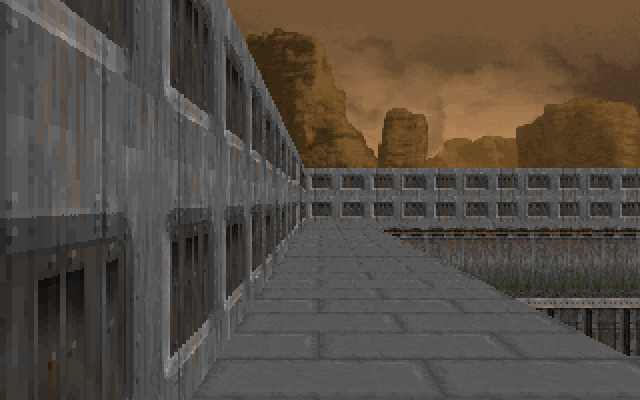
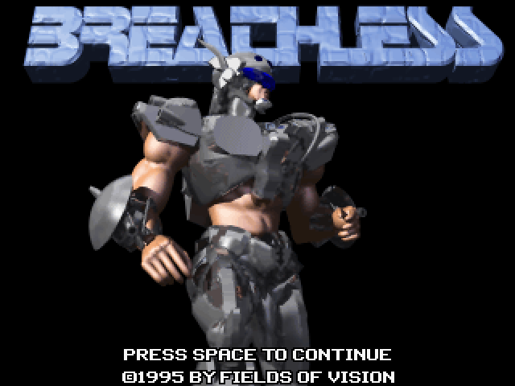
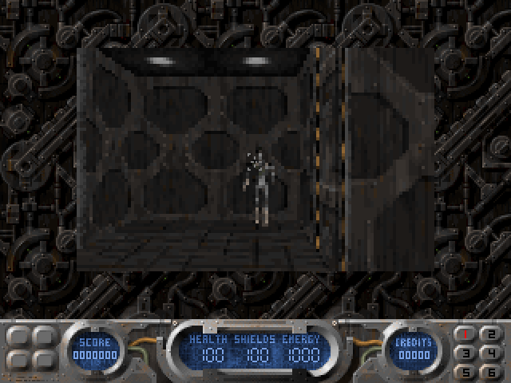
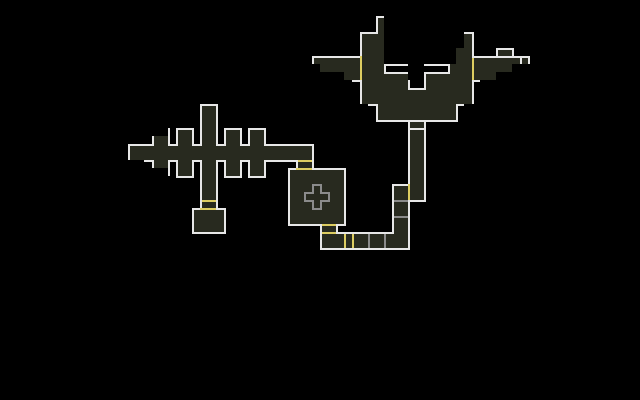
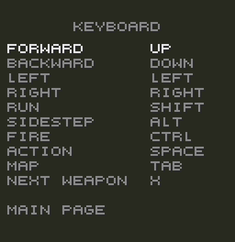
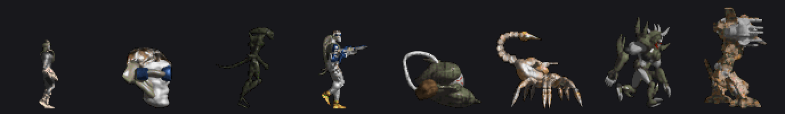
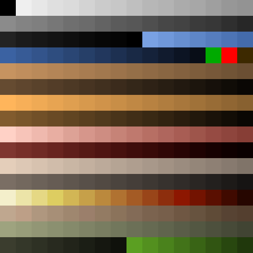

# Breathless Java

*[Version française](README_fr.md)*

A Java port of **Breathless** (Fields of Vision, 1995-96), a texture-mapped FPS for the
Amiga AGA. jMonkeyEngine provides the window, the keyboard and the sound.


The engine is rewritten from the original 68k assembly: raycaster, sprites, effects,
combat, AI, status panel, map, terminal, sound and music — and checked against the
game data.

**This is not an emulator**, neither of the Amiga nor, even partly, of the 68000: no
68k instruction is executed, and the original binary is not loaded. Every routine
of the assembly has been read and rewritten in Java; the only thing the game takes from the
original is its **data** — levels, textures, sprites, sounds, music —, read from the `.GLD`
files as they are shipped. Nothing emulates the graphics chip or the sound chip either: the
renderer is a software raycaster, the music a ProTracker player written for the purpose.



## Design choice

**A faithful port of the raycaster.** The original engine is rewritten in Java identically:
DDA ray casting one pass per column, rendered into a 320x200 *chunky* buffer with a
256-colour palette. jMonkeyEngine only displays this buffer as a full-screen
texture, and handles the window, input and audio.

This choice favours pixel fidelity over making use of the GPU. The
consequences are accepted:

- no real 3D, hence no free vertical rotation — only the original's vertical shift
  of the view (`LookHeight`), which the port carries over;
- the geometry remains constrained to the block grid;
- most of the work is a 1:1 port of documented assembly code.

**Original formats read directly, and exportable.** The game opens the `.GLD` files as
they are — decompression included — which avoids maintaining a copy of the data. The
`gld-cli` tool is used to *inspect* them: it exports textures, sprites, pictures, sounds, ProTracker
modules and maps as PNG, WAV and `.mod`. It is through this tool that each format was checked
before being wired into the engine.

## Structure

| Module | Role |
|---|---|
| `gld-core` | reading the original formats: SLZ/VDCO decompression, `.GLD` parsers |
| `engine` | raycaster and software rasterisation — pure Java, no graphics dependency |
| `gld-cli` | command-line tools: inspection, PNG export, rendering of still images |
| `game` | jMonkeyEngine shell: window, input, audio |

The engine is deliberately isolated from jMonkeyEngine: it produces a 320×200 buffer of
palette indices, which the shell merely displays. This makes it possible to test and
debug it by writing PNGs, without opening a window.

A complete frame costs about **0.13 ms** on one core, i.e. on the order of 7,000 frames
per second. Software rendering will not be the limiting factor, and nothing is allocated
during a frame.

### The three passes of a frame

1. **Rays** — one DDA per column, which records only the block *changes*.
2. **Walls** — vertical spans from nearest to farthest, with two clipping bounds
   that close in. The pixels left free are marked "floor" or "ceiling" of a given
   block.
3. **Horizontal surfaces** — the marked pixels are grouped into segments per line.
   Along a line, the depth is constant: the mapping there is affine, hence linear.
4. **Objects** — sprites sorted from farthest to nearest, each column clipped
   against the bounds the wall pass left at that depth. No depth
   buffer: an object behind a wall disappears by itself.

### Effects

Each block carries a **trigger number**; all those sharing the same number
move together, which is why a door three cells wide opens in one piece.
Walking onto a block fires its effect list, each entry targeting a trigger. An effect
occupies one of 42 slots and advances one step per fiftieth of a second until it
removes itself.

Floor and ceiling heights therefore live in a **mutable state** of the world, separate
from the blocks coming from the file, which remain the intact original description.

A door refuses to close on the player or on an enemy: it goes back up,
pauses again, and retries. The remains of an enemy that fell beneath it disappear when it
closes.

Two ways of finishing, and the difference shows: an effect that comes and goes — a door, a
lift — hands its trigger back, and starts again on the next pass; a
**permanent** effect — a ceiling that comes down, a door that stays open, a light that
changes — keeps it forever. Without this, a ceiling would come down again on every pass
until it went below the floor.

A switch requires the **key** carried by the entry: without it, nothing opens and the game
says so; with it, the key is used, and disappears.

The three kinds of doors do not look alike, and what sets them apart is the plane they
move: **`DoorUp`** raises the ceiling, **`Door2`** — the "a due ante" door, with two
leaves — raises the ceiling *and* lowers the floor by the same amount, **`DoorDown`** lowers the floor
alone. Level 1 has eight of them, four of each extreme kind; the two-leaf
doors only appear from the fourth level onwards.

### Animations

Two rates, both slower than the display:

- **textures**: one frame every 8 (6.25 per second);
- **objects with simple animation**: one frame every 4 (12.5 per second).

An object's animation belongs to its **type**, not to its instances: all the acid
drums in a level bubble in unison. Enemies have their eight walking poses,
locked to the clock as `WALKANIM` does, and their firing and falling poses; shots and
explosions advance at 12.5 frames per second.

Actual usage across the twenty levels, which guided the priorities:

| Effect | Occurrences | Status |
|---|---:|---|
| Wake an enemy | 519 | ported |
| Door, Door 2, Down door | 311 | ported |
| Lifts | 66 | ported |
| Moving floors and ceilings | 14 | ported |
| Flashing lights | 39 | ported |
| Terminal, teleport, end of level | 112 | ported |
| Linked lights | 37 | ported |

Effects 1, 9, 10 and 18 of the catalogue are used by no level.

The specification of the binary formats is in [`docs/formats-gld.md`](docs/formats-gld.md).

## Installing

The [releases](https://github.com/guillaumemonet/breathless-java/releases) page carries
one archive per system. There is nothing to install: unpack it, and run
`Breathless`. The package carries its own Java; none is required on the machine.

**The game data is not included** — this repository redistributes none of it. On first
launch, the game asks whether it may fetch the archive of the original sources,
[mheyer32/Breathless](https://github.com/mheyer32/Breathless), about 2.5 MB. It
stores it once and for all in the user's directory — `%LOCALAPPDATA%\Breathless\data`
on Windows, `~/Library/Application Support/Breathless/data` on macOS,
`~/.local/share/breathless/data` on Linux — and later launches find it
without asking anything.

A local copy always takes precedence, in this order: the directory given as an argument, the
`-Dbreathless.data=<path>` property, the archive placed next to the game, then the one a
previous launch stored. Anyone who already has the sources therefore has nothing to download.

## Building and running

Requires JDK 21 (the Gradle *toolchain* takes care of it).

```bash
gradle build

# Inventory of the original data files
gradle cli --args="probe <path to the .GLD files>"

# Summary of the twenty levels
gradle cli --args="levels <path to the .GLD files>"

# Details of one level, with an ASCII preview of the map
gradle cli --args="level <path>/BLES0006.GLD"

# Export of a level's automap, at the start and then complete
gradle cli --args="map <path to the .GLD files> <path>/BLES0006.GLD <output>"

# Export of the ten full-screen pictures as PNG
gradle cli --args="pictures <path to the .GLD files> <output directory>"

# Conversion of the P61A tunes into ProTracker modules, and WAV rendering
gradle cli --args="modules <path to the .GLD files> <output directory>"

# Inventory of the sound bank and export of the sound effects as WAV
gradle cli --args="sounds <path to the .GLD files> <output directory>"

# Export of the four terminal pages
gradle cli --args="terminal <path to the .GLD files> <output directory>"

# Export of the status panel, empty, filled, and under a game view
gradle cli --args="panel <path to the .GLD files> <output directory>"

# Export of the palette, the lighting ramp and the 97 textures as PNG
gradle cli --args="textures <path to the .GLD files> <output directory>"

# Export of the object sprites as transparent PNGs
gradle cli --args="sprites <path to the .GLD files> <output directory>"

# Rendering of still views from a level's starting point
gradle cli --args="render <path to the .GLD files> <path>/BLES0006.GLD <output>"
```

### Building the package

```bash
gradle :game:packageZip
```

`jpackage` produces a self-contained directory, with its own JRE and the game executable, which
the task compresses into `game/build/distributions`. It can only be built for the system
that builds it: this is a `jpackage` constraint, not a choice.

The runtime is reduced to the modules actually used, and only the LWJGL natives of the
target system are bundled — otherwise the archive would weigh twice as much.

### Android

The release also carries an **APK**, for Android 14 or later. It is installed outside
the store: allow installing apps from this source, then open the
file. As on the desktop, it contains no game data and offers to
download it on first launch; it is stored in the app's
storage.

The picture keeps its proportions in the centre of the screen, in landscape, and the touch controls
occupy the strips left free:

| Control | Action |
|---|---|
| Joystick, on the left | move forward, back, turn; pushed all the way, run; in a menu, move the selection |
| FIRE, ACTION, WEAPON, MAP, MENU, on the right | as on the keyboard |
| Touching the picture | skip a still screen, confirm a menu choice |
| Back | menu |

At "REALLY QUIT ?", lacking Y and N keys, ACTION answers yes and MENU no.

The APK is built separately, in `android/`, a Gradle build that takes the sources of the
engine and the shell as they are — only the command-line launcher and the
Swing dialog boxes are left out. It requires the Android SDK:

```bash
cd android
./gradlew assembleRelease
```

The APK is signed with the debug key: it installs as is, but could not be published
on a store.

### Playing

```bash
gradle :game:run --args="<path to the .GLD files>"
```

| Key | Action |
|---|---|
| Arrows, ZQSD or WASD | move forward, back, turn |
| `,` and `.` | sidestep, which combines with turning |
| Alt | forced sidestep (the left/right keys move instead of turning) |
| Home / End | look up / down; Insert straightens the view |
| Space, E or Enter | **use**: open a door you are facing, call a lift |
| Ctrl | fire |
| Shift | run |
| Tab | **map** — it replaces the view and pauses the game, as in the original |
| 1 to 6 | choose a weapon |
| X | next weapon |
| + / − | enlarge or shrink the game window |
| Keypad 7 8 9 0 | pixel size: 1×1, 2×1, 1×2, 2×2 |
| Page Up / Down | change level |
| P | pause |
| Esc | configuration menu — it holds the quit command |

The controls in the first half of the table can be redefined in the keyboard page of the
menu, like the original's thirteen; the map, pause, weapons and display
settings keep their keys.

On startup, the game shows the graphics card it is using (`GL_RENDERER`). On a
laptop with two graphics cards, Windows gives the integrated card to `java.exe`: the game then reports it
on screen and asks whether it should continue. The fix: Windows Settings →
System → Display → Graphics → add `java.exe` and `javaw.exe` → "High
performance". `-Dbreathless.gpu=ok` keeps the warning but no longer asks the question.

The simulation runs at a **fixed step, 50 Hz** — the PAL frequency the original movement
constants were tuned for. The display, for its part, follows the screen's refresh rate.

The integration tests on the original data are skipped if the data is
absent. To enable them:

```bash
gradle test -Dbreathless.data=<path to the .GLD files>
```

### Still screens




The graphics bank contains ten full-screen pictures — the title, the four world
introductions, two logos, the credits, the game-over banner and the final screen. All
are compressed in **VDCO**, the same compression as the `.GLD` containers. Each picture
carries its own palette, which replaces the game's while it is displayed, and its own
position: the title covers the screen, the game-over banner is only 288×40 and sits in the
middle.

The sequence is the original's. The two logos then the title, over the title
music; a key opens the introduction menu, from which **START GAME** starts the game
at the level given by the access code. Each level opens on its **loading screen**:
the world picture, the world and arena names read from the master file
`BREATHLESS.GLD`, the remaining attempts and the access code, over the `MUSL` music;
a key starts the level. Death makes the player collapse, then restarts the level
if attempts remain; otherwise the game-over banner, then the title — the access
code remains that of the last level reached. The credits, the final screen and the banner
move on by themselves when their time is up; a key cuts them short.


The loading screen texts are placed where `LoadingScreen` places them, in
colours 254 and 255 of the picture's palette — hence the red of "PRESS ANY KEY TO
START". The first level of the first world shows no code: it is the starting
code.

### The game window



Eight sizes, from 96×60 to 320×200 in steps of 32×20, and four pixel sizes: 1×1,
2×1, 1×2, 2×2. This is how the original was tuned to gain speed — fewer
columns and lines to compute, with the picture remaining the same size on screen. Rendering is
done at the reduced size and then repeated: a double pixel is a big pixel, not a smoothed
picture.

A reduced window reveals the **backdrop** surrounding it, `Graphic/Background01.raw`,
a 128×128 tile repeated over the whole view.

### Level codes

Sixteen characters capture a game: health, shields, energy, credits, the six weapons
with their upgrade, the weapon in hand, the world and the level. Ten bytes are assembled,
scrambled by an exclusive or with a 32-bit key, then cut into sixteen groups of
five bits — hence an alphabet of thirty-two symbols, `1` to `9` then `A` to `W`.

The port is **exact**: the starting code hard-coded in the game,
`181CEIGGLJRJSE2T`, reads back and **rewrites character for character**. A test
checks it, and it is this test that revealed the only remaining discrepancy — the original applies its key
as two long words then *one word*, so that the last two bytes see the low word
of the key and not its high word.

Each level's loading screen shows its code, which becomes the access code. It can be
entered in the game options, before the game, and is also accepted at launch:

```bash
gradle run --args="../Breathless 181CEIGGLJRJSE2T"
```

### The map



Tab shows the map: it replaces the view and pauses the game, exactly like
the original. The survey is made as you advance — three rays leave from the player's view and
mark the cells crossed up to a wall or a closed door. The drawing tells what each
passage is worth: **white** impassable, **grey** passable, **yellow** step or
ceiling change, dark background for floor already surveyed.

### Sound

The `SGLD` bank has the same shape as the graphics bank: a catalogue of four-character
names, each pointing to a sixteen-byte record — length, Amiga
period, volume, loop, priority, channels, type. Three kinds of records, which
`InitAudio` sorts out and the parser reproduces:

- the sample follows the header;
- the header carries the **name of another sound**, whose sample it reuses with its own
  period and its own volume — a Devil's scream is that of another monster, played lower;
- the header is a **random draw** between three named sounds.

Forty of the forty-seven entries are sound effects, seven are tunes. The frequency
is derived from the period: `3546895 / period`, the PAL clock.

The sound effects are played: a door rolling then hitting its stop, switch, teleport, footsteps,
pickup, shot, empty weapon, impact, death, explosion, enemy waking, player's scream. As
on the Amiga, they share **four channels**: each has its priority, which distance
lowers, and its volume drops with it until it falls silent beyond twenty-two blocks. A
"single" sound does not restart while it is playing, and a door keeps its channel, so that
the end-of-travel thud cuts off the rolling.

#### Music

The seven tunes are in **P61A** format — The Player 6.1, a packer for ProTracker
modules. The decoder is written from the **public description of the format**, that of
Huw Price's [p61aconv](https://github.com/howprice/p61aconv) tool under the MIT licence,
itself based on the Player61A guide. It borrows nothing from the original player, which
belongs to Jarno Paananen: it is the format that is reimplemented, not its code.

A P61A module stores its patterns track by track and compresses them by repetition: empty
lines, identical lines, and backward jumps to replay a block already read. Once
unfolded, you get exact ProTracker — same period table, same effects.

The conversion is checked on the seven tunes: **none of the roughly 8,300 notes
falls outside the ProTracker period table**, the `.mod` files produced are
exactly the size their header announces, and the sequences only target existing
patterns.

A ProTracker player then renders the tune to audio — four mixed voices, arpeggio,
portamento, vibrato, volume slides, position and pattern jumps, speed
settings. Rendering is done once, away from the main thread, then the tune plays in a
loop.

### The teleport and the end of level

The teleport fades the picture into the fog then brings it back, and freezes the game for the
round trip; at thirty-two fiftieths, at the height of the fade, the player is set down
at the centre of the target cell, momentum cut. The end of level raises the exit flag; the
main loop then fades the picture to black before moving on, and each level opens
with the reverse fade.

The **linked light** follows the travel of another effect: a door going up lights the room
as it opens, in proportion to its progress.

### The configuration menu


Esc opens the menu, on the same monitor as the terminal — same font, same pages,
same positions as `conf_page0` to `conf_page5`. In game: back to the game, window, sound,
keyboard, controls and **QUIT GAME**, which asks "REALLY QUIT ? (Y/N)" and returns to the
introduction. Before the game: **START GAME**, the same pages, the game options and the
credits. The arrows move the selection — wrapping from one end of the page to the other —, left and
right cycle a value, Space confirms.

The **keyboard** page redefines the original's thirteen controls: choosing a line puts the
menu on hold, the next key is assigned, and the control that was using it loses it.
Reserved keys — Tab, Esc, P, 1 to 6, F1 to F6 and the port's fixed keys —
are refused, as `keylist` refused them. Esc cancels.



The **controls** page sets the inertia of walking and turning, and the speeds, on
foot and running, as `AdjustConfigVars` translated them.

The **game options** page, before the game, lets you **enter** the access code — checked,
"BAD ACCESS CODE !" otherwise —, reset it to the starting code, and save the settings
to `breathless.config`, loaded again at the next launch.

### The terminal


A block effect opens the terminal, and the game stops while it is up — the first
level has one, the following ones up to three. It is the **game's only source of weapons**:
`CollectWeapon` and `BoostWeapon` are called from nowhere else. Four pages —
welcome, weapons, upgrades, accessories — with the original prices, from 150 credits for
ten shield points to 35,000 for the Death Machine.

You navigate it with the same keys as in game: forward and back move the selection,
Space confirms.

The original draws this menu with hardware sprites, on a 128×132 monitor placed at the
top left, in two colours on a transparent background. The texts, their positions and the
prices are the original ones; the background is opaque here, otherwise the text gets lost in the
scenery, and the exact tints of the sprites cannot be deduced from the source.

### Combat

Firing is counted in **presses**, not in time: each press queues a shot, the queue
empties by one shot per frame, and there is no other reload delay. All weapons
are therefore single-shot — except the flamethrower, the only one carrying the bit that makes it
continuous. No weapon has autofire in the data, and the code that would have handled it is
commented out in the original.

An enemy that is shot down **falls** in the direction of the shot, eight steps per frame, then stays on the
ground: it is no longer an enemy, no longer moves and no longer stops shots. The fall does not have
a fixed length — it stops as soon as the frame no longer changes, which makes two frames
for some and three for others.

Five of the twelve enemies — WALK, EYE1, SKUL, TERM and SPID — have **no** falling
animation and **explode** on the spot. It is their last firing frame, equal to what would be
the first of their fall, that tells. What they leave behind then depends on their
explosion: the enemy's corpse for some, the last frame of the explosion for
others. In every case something remains on the ground. A shot that itself explodes — the
fireballs, the plasma — makes any enemy explode, falling or not.

Enemies do not decide at every step: `obj_cont1` spaces out their decisions, from three
passes when they are aiming to forty-seven after an obstacle, which gives them their
straight lines. They go around an obstacle in a direction they keep until they get past, do not
pass through one another, strike the player on contact, and only move if they are less than
twenty blocks away or were seen in the last frame.

These three comparisons are on the **identity** of the frames, not their content: the
original engine compares pointers, and the object bank therefore shares a single
instance per frame, however often it is referenced.

A body that is falling **takes nothing more**. The shot does stop on it, but neither
wounds it nor kills it a second time — `MSctrlobjcoll1` says so in so many words, *« se il
nemico sta cadendo non deve ucciderlo di nuovo »*. Without this a burst gives the body back a
living status mid-fall: it stops being dead without becoming alive again, freezes, and the
renderer gives it a walking pose again — the enemy stays standing.

A negative status — the enemy is firing, falling, or lying down — makes its frame be taken at the
absolute index, without going through the direction octant.

Three attempts, as in the original: death uses one up and restarts the level;
once they run out, the game stops and you return to the title.

### Objects

Sprites are encoded as Doom-style "posts": per column, opaque vertical segments
separated by empty space. Forty-three object types, including a dozen enemies,
each with its directional poses and its walking, wounded and death animations.



### Waiting objects

Nearly half the objects in a level wait for a trigger — eighteen out of
thirty-nine in the first level. This waiting does not make them absent: the original engine
writes them into the map at load time (`InitObjects`, TMapMain.asm) and only checks
`obj_inactive` when it comes to moving the enemies. A waiting enemy **can be seen,
stops shots and takes hits**; it merely stays still until it wakes.

### The status panel


The original screen is 320×240: the view occupies the first two hundred lines, the panel
the last forty. Its background is not in a `.GLD` — it was assembled into
the executable by `incbin "Graphic/Panel04.raw"`, an eight-bitplane image that
`PlanarImage` unfolds into palette indices. The digits come from the two fonts of
`Text.asm`, transcribed once and for all in `ScoreFont`.

An installation containing only the data files will not have this image:
the game then starts without a panel and falls back to reporting on the console.

### The palette and the lighting ramp

The game's 256 colours, and the thirty-two lighting levels that make them darken
with distance — a simple index-to-index table, as in the original.



## Deliberate departures

The port follows the original engine down to its quirks. A few points deserve
to be mentioned because they are surprising:

- **A shot does not test its target's height.** The original only takes it into account for the
  player; aiming above an enemy does not save it.
- **Scenery stops shots.** Any object of a type lower than or equal to an enemy is an
  obstacle: a pillar protects what is behind it.
- **Between two targets in range, the nearest one takes the hit.** The original takes the
  first in its cell list, that is, a placement order — two enemies side by
  side would then steal each other's hits.

And a few departures in form, for lack of an equivalent:

- **The terminal and menu monitor has an opaque background**, where the original uses
  transparent sprites; its exact tints cannot be deduced from the source. The
  in-game messages, for their part, are printed transparently.
- **The mouse is not used**: the controls page only offers the keyboard. The
  **audio filter**, a low-pass of the Amiga hardware, gives up its line to the sound
  effects switch.
- **The default keys** follow today's habits; the original's —
  left Alt to fire, Ctrl to run, Shift to sidestep — can be restored in
  the keyboard page.
- **Animated textures** advance at 6.25 frames per second, the intended rate. The
  original's depended on the machine's display speed.
- **The loading screen** writes with an eight-pixel fixed-width font: the
  original's, the Amiga system font, is not part of the data.
- **A looping sound** — only the flamethrower does this — replays its whole sample, where
  the original only replays the part that follows the loop point.
- **Pixels** are 1×1 on first launch, not 2×2.

The audit that compared the port to the sources, point by point, is in
[`docs/audit-sources.md`](docs/audit-sources.md).

## Roadmap

- [x] **Foundation** — SLZ/VDCO decompression, `.GLD` container, validated on the 25 files
- [x] **Level data** — `LGLD` parser, validated on the 20 levels
- [x] **Textures and palette** — `TGLD` and `GGLD` parsers, PNG export for checking
- [x] **Raycaster and walls** — 16.16 DDA, main, upper and lower textures,
      table-based lighting; rendering checked on the 20 levels
- [x] **Floors, ceilings and sky** — perspective by horizontal segments
- [x] **Milestone 1: walking through a level** — movement with inertia, collisions and
      sliding along walls, jMonkeyEngine window
- [x] **Objects and sprites** — `OGLD` parser, sprite rendering with depth sorting
      and clipping against the scenery
- [x] **Milestone 2: the world moves** — doors, lifts, moving floors and ceilings,
      enemy waking, flashing lights, texture and object animations
- [x] **Player state** — health, shields, energy, credits, keys; object pickup
      and harmful floors
- [x] **Weapons and projectiles** — six weapons, firing, flight, impacts and explosions
- [x] **Enemy AI** — chasing, wandering, aiming, firing and walking animation
- [x] **Status panel** — the five counters, the key indicators and the six weapon
      numbers, on the original image
- [x] **Automap** — survey by three rays, passages drawn according to whether they can
      be crossed
- [x] **Terminal** — the four shop pages, the original prices, purchases of weapons,
      upgrades and accessories
- [x] **Milestone 3: the game** — status panel, map, terminal, teleport and end of level.
      **All seventeen effects of the original engine are ported**: a test plays all the
      lists of the twenty levels and checks that none is missing
- [x] **Sound effects** — `SGLD` parser, links and draws, WAV export, in-game playback
- [x] **Music** — P61A decoder, conversion to ProTracker, player, music per level
- [x] **Crosshair** — the original pattern, in the centre of the view
- [x] **Level codes** — exact encoding, checked against the game's code
- [x] **Display settings** — eight window sizes, four pixel sizes,
      background backdrop
- [x] **Still screens** — title, world introductions, game over, decompressed
      from the graphics bank
- [x] **Configuration menu** — window, sound, crosshair, game code
- [x] **Milestone 4: finishing touches** — audio, music, level codes, crosshair, display
      settings, still screens and menu
- [x] **Audit against the sources** — permanent effects and keys, AI paced by
      `obj_cont1`, player/object and enemy/object collisions, falling, vertical look,
      bobbing, sprite rendering according to pixel size, sky, fades, loading screen,
      original menus, messages, four-channel sound
- [x] **Game behaviour** — three attempts, pause, single-shot fire rate, enemy
      falls, points scale, complete screen sequence, key
      redefinition and saving of settings

## Legal Notice & Game Assets

### Independent Engine Implementation

This project is an independent reimplementation of the *Breathless* engine, designed to reproduce the original game's behavior on modern platforms.

The engine has been developed from the original source code, released as freeware by *Amiresource* magazine ([mheyer32/Breathless](https://github.com/mheyer32/Breathless)), through technical analysis and compatibility testing. That source code is not included in this repository.

The original `Leggimi.txt` asks that any derived product be strictly freeware itself, with no direct or indirect profit. **This repository is freeware.**

### Original Game Files

This project requires original game files, such as the original source archive, which holds the game data, to run.

**Original game files are not included in this project.**

Users must obtain and provide their own game files from a legally authorized source. Before downloading or using this engine, users are required to confirm that they possess a legally obtained copy of the original game.

Neither this repository nor the published packages contain the game data. On first launch the game offers to fetch the archive where its authors published it, and only with the user's consent; a local copy always takes precedence.

Eloane Studio does not host, distribute, or provide unauthorized copies of copyrighted game assets.

### Copyright & Trademarks

All original game names, trademarks, graphics, music, and other proprietary assets of *Breathless* remain the property of their respective copyright holders (Fields of Vision).

This project is an independent, unofficial implementation and is not affiliated with, endorsed by, or sponsored by the original game's developers or publishers.

### Preservation

The purpose of this project is to preserve the technical behavior and gameplay experience of classic video games while making them accessible on modern systems.

The engine is provided for compatibility, preservation, and educational purposes.

### Credits

Original game: Fields of Vision (1995-96). The P61A module player shipped with the sources is by Jarno Paananen; this port does not use it: its decoder reimplements the *format* from the public description in [p61aconv](https://github.com/howprice/p61aconv), under the MIT licence. Java port: **Guillaume Monet**.
